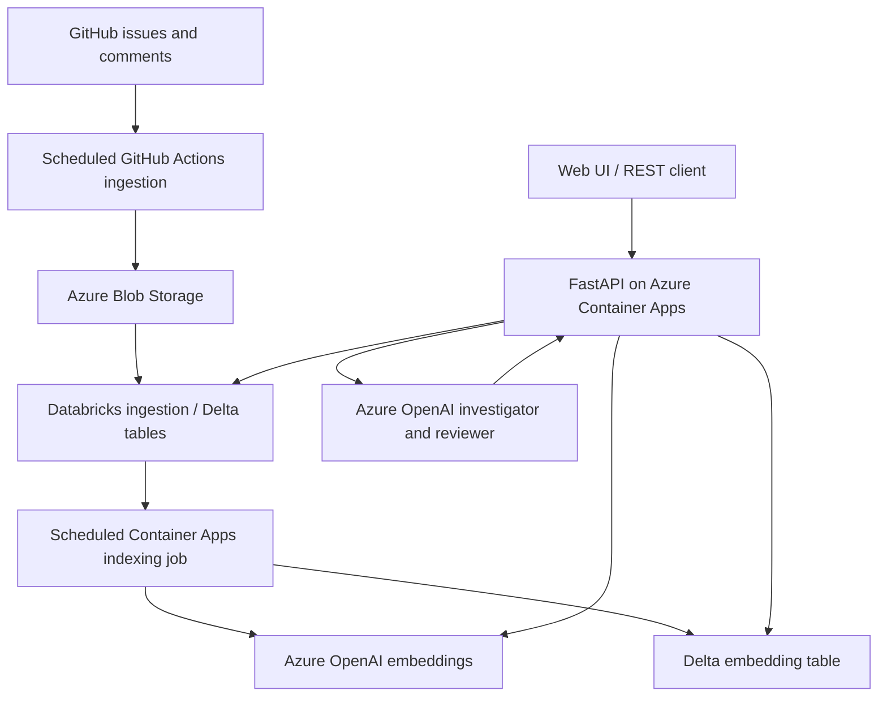

# OpsForge

AI-assisted IT incident investigation using historical Apache Airflow issues and comments. OpsForge retrieves comparable incidents, proposes evidence-grounded hypotheses and recommends diagnostic steps for human review. It does not execute remediation.

## Architecture



## Retrieval and investigation

- Historical issues and comments are stored in Unity Catalog Delta tables.
- The indexer embeds issue titles and truncated descriptions, normalizes vectors and stores content hashes for incremental updates.
- Full-corpus retrieval computes exact similarity over stored vectors using SQL; this is not an approximate nearest-neighbor vector index.
- If index coverage is insufficient or vector retrieval fails, lexical candidate retrieval and semantic reranking provide a fallback.
- Two sequential LLM calls implement investigation and evidence review. They use the same deployed model; this is not independent expert validation.
- Historical evidence is treated as untrusted input; output citations are restricted to retrieved issue numbers.

## Operations

The API is deployed from GHCR by GitHub Actions using Azure federated identity and commit-specific image tags. The indexing job is configured separately in Azure Container Apps Jobs with a daily schedule (06:00 UTC, verify it follows ingestion). CI/CD deploys the indexer using commit-specific image tags through a separate deployment job, gated by AZURE_INDEXER_DEPLOY_ENABLED=true. The federated deployment identity requires Container Apps Jobs Contributor scoped to the indexing job (and Container Apps Contributor scoped separately to the API). Both deployment jobs and the indexer image verification succeeded in workflow run 45384646078.

### Indexer

```bash
python -m app.vector_index
```

The embedding table must already exist. The indexer skips unchanged content using hashes and commits each batch. Interrupted runs may be restarted. Avoid concurrent indexing executions. Monitor Azure OpenAI rate limits, Databricks query history, job execution status and token expiry.

Required configuration (use secret references for credentials):

| Variable | Purpose |
|---|---|
| AZURE_OPENAI_ENDPOINT | OpenAI-compatible Azure endpoint |
| AZURE_OPENAI_API_KEY | Azure credential |
| AZURE_OPENAI_DEPLOYMENT | Chat deployment |
| AZURE_OPENAI_EMBEDDING_DEPLOYMENT | Embedding deployment |
| DATABRICKS_SERVER_HOSTNAME | Workspace hostname |
| DATABRICKS_HTTP_PATH | SQL warehouse path |
| DATABRICKS_TOKEN | Read credential |
| DATABRICKS_WRITE_TOKEN | Indexer-only write credential |
| DATABRICKS_CATALOG | Catalog |
| DATABRICKS_SCHEMA | Schema |

Keep the write credential restricted to indexing. Standalone indexing has succeeded and removal of the API write credential has been initiated. Verify API functionality and removal of unused secrets and older active revision references before declaring separation complete. Do not commit credentials. Verify API authentication before external exposure; CORS is not authentication.

### API

- GET /api/health
- POST /api/analyze with JSON fields title and description
- GET / provides the web interface

Analysis responses contain historical evidence, hypotheses, recommended steps, missing information, retrieval method, review status and performance metrics.

## Evaluation

```bash
python -m app.evaluate --url "$OPSFORGE_URL" --cases labeled_cases.jsonl --output evaluation.json
```

Provide independently reviewed JSONL cases with title, description and relevant_issue_numbers. The evaluator currently measures cited-evidence overlap, not all retrieved candidates or confirmed diagnostic accuracy. Labels may be incomplete; report this limitation. Measure warm and cold warehouse latency separately, and report chat token use alongside retrieval latency. Do not interpret model confidence as a calibrated probability.

## Validation status

- Initial full index: 15,509 issues successfully indexed in the observed deployment.
- Full-corpus semantic retrieval observed on an Airflow scheduler incident.
- Scheduled execution succeeded on 2026-11-24 at 06:00 UTC: 15,512 scanned, 3 changed and embedded, 58 seconds application runtime (94 seconds platform execution duration). GitHub ingestion is scheduled at 02:17 UTC and triggers Databricks asynchronously; indexing starts independently at 06:00 UTC. This is not a guaranteed completion dependency. Earlier embedding authentication failures are unresolved historically, although the successful execution and subsequent direct authentication check confirm current functionality.
- CI includes credential-free regression tests for SQL query assembly and query-count behavior. These do not replace integration tests against the deployed Databricks warehouse.
- Evaluation CLI reports mean cited-evidence precision/recall/hit and end-to-end latency, plus median/p95 latency, retrieval-method counts and chat token totals when available. No independent labeled benchmark or comparative accuracy measurements have been collected yet.
- Independent evaluation and production security review remain outstanding.

## Limitations

Issue descriptions and comments are truncated. Index readiness uses approximate count coverage rather than per-record freshness; deleted issues and embedding model changes require explicit maintenance. Historical similarity is not proof of root cause. SQL warehouse startup, exhaustive vector scoring, rate limits and sequential LLM review can increase latency. No autonomous infrastructure changes are supported.
